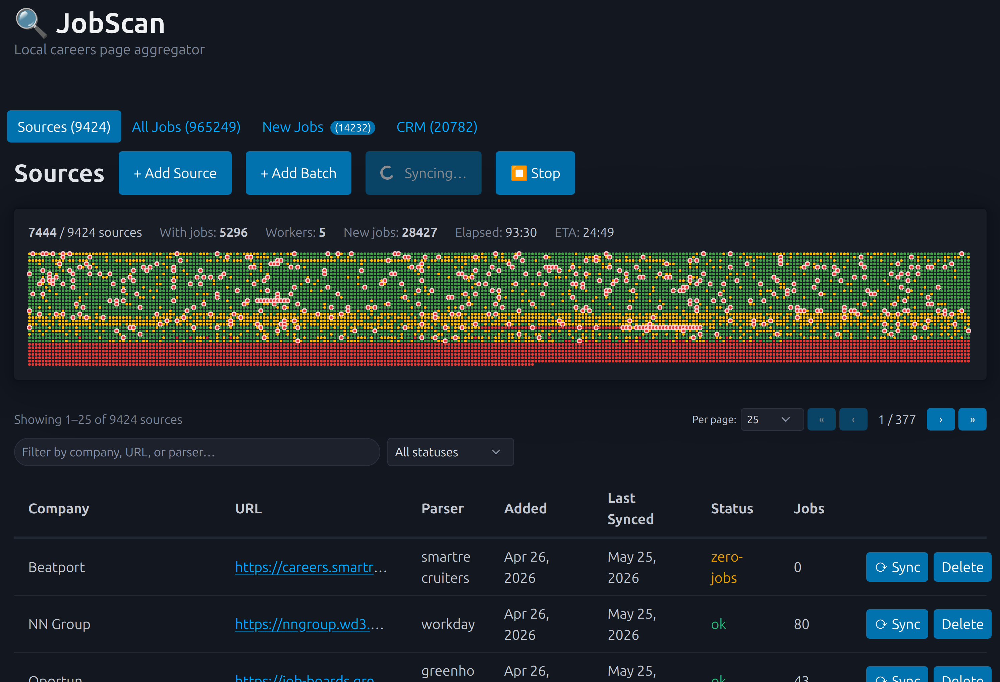
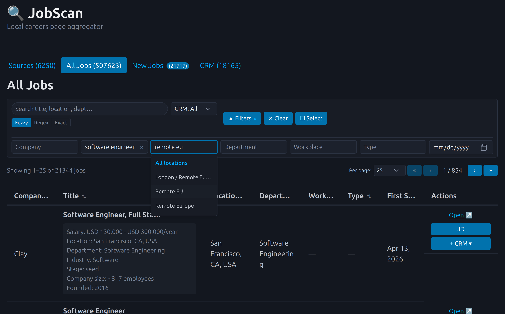
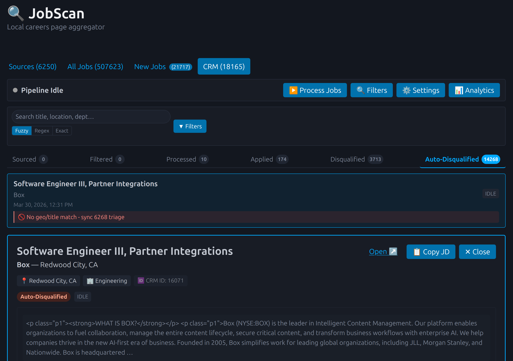
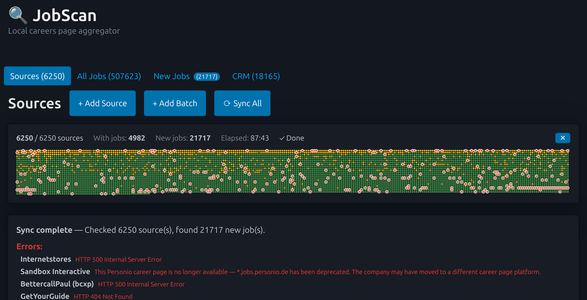

# JobScan

JobScan is a self-hosted job-search workspace. It tracks company career-page sources, scrapes and caches job listings, lets you search/filter them in a web UI, and manages selected roles through a lightweight CRM pipeline.



This repository contains two packages:

- `jobscan/` — TypeScript/Express web app and scraper backend.
- `jobscan-mcp/` — MCP stdio server that exposes JobScan REST API tools to MCP clients.

## What this is

JobScan started as a private, vibe-coded personal project for making my own job search less manual. I used it daily for a few months; it is not a polished SaaS product, but it already does useful work. If it helps you, take it, deploy it, fork it, improve it, or continue supporting it for your own workflow.

The project intentionally avoids a separate frontend app. There is no React/Vue/Svelte build pipeline and no dedicated frontend package. The UI is plain, ugly, server-served HTML/CSS/JS on purpose: fewer moving parts, easier VM deployment, easier debugging, and good enough for a self-hosted tool.

## Security and warranty warning ⚠️

JobScan is **designed for personal use**, not as a hardened multi-user production service. It was built to solve one person's job-search workflow and still has many known and potential security issues. Use it at your own risk.

Known important risks include, but are not limited to:

- **No built-in user accounts or app-level auth.** Remote deployments rely on `oauth2-proxy` or another reverse proxy. If you expose the app port directly, the API is effectively open.
- **SSRF / internal network access risk.** The app fetches user-configured career-page URLs from the server. A malicious or mistaken URL may make the server request internal services, cloud metadata endpoints, or other private network targets.
- **Stored XSS risk.** Job descriptions and other scraped content come from third-party pages and are rendered in the UI. Malicious upstream content may execute in the browser if sanitization is incomplete.
- **CSRF risk with cookie-based proxy auth.** Browser-authenticated deployments may allow cross-site requests to trigger syncs or mutations unless additional protections are added.
- **Secret exposure risk.** LLM/API keys and CRM/job data may be stored in the database and visible to anyone who can access the app/API.
- **Sensitive data in logs and DB.** URLs, job descriptions, CRM notes, LLM prompts/responses, and processing results should be treated as private operational data.
- **Supply-chain/browser risk.** The simple frontend may load third-party browser dependencies and does not currently aim for strict CSP/SRI hardening.

There is no warranty, no security guarantee, and no promise that this is safe for production or internet exposure. If you decide to run it, keep it private, protect it with strong reverse-proxy authentication and TLS, review the code/configuration yourself, and make backups.

## Current scale target

The current design is meant for personal/self-hosted scale, roughly:

- about 10k tracked career-page sources
- sources spread across many ATSes and custom career pages
- daily sync on a small cloud VM
- up to about 1m cached jobs in the database
- about 20k CRM jobs across different pipeline stages
- proven on a small 1 vCPU / 2 GB RAM VM

This is not a guarantee or benchmark. It describes the scale this tool has been shaped around in real use.

<details>
<summary>Additional screenshots</summary>

### All jobs search



### CRM auto-disqualified jobs



### Source scan result



</details>

## Current status

JobScan is being cleaned up for public self-hosting. It is intended to run in a trusted self-hosted environment, typically behind `oauth2-proxy` or another reverse proxy.

Do not expose the app directly to the public internet without authentication and TLS.

## Quick start

### Local development

```bash
cd jobscan
npm ci --include=dev
npm run dev
```

Open `http://localhost:3000`.

Local development uses SQLite by default and creates `jobscan/data/jobscan.db` automatically.

### Docker deployment

```bash
cd jobscan
cp .env.example .env
cp emails.example.txt emails.txt
cp htpasswd.example htpasswd
# edit .env, emails.txt, and htpasswd
docker compose up --build -d
```

The Docker setup uses PostgreSQL and oauth2-proxy. The web UI is exposed through oauth2-proxy on port `3050` by default.

## Security notes

- The app itself is a self-hosted single-user tool and currently relies on reverse-proxy authentication for remote deployments.
- The API can mutate CRM records, trigger syncs, and fetch configured career-page URLs.
- Keep `.env`, `emails.txt`, `htpasswd`, SQLite DBs, logs, and local MCP config files out of git.
- Rotate any credentials that were ever committed before publishing a repository publicly.

See `SECURITY.md` for vulnerability reporting and deployment cautions.

## Development commands

From the repository root, everything is bound through npm scripts:

```bash
npm run check:env    # one-time sandbox bootstrap: Postgres + install/build + dev server
npm run check:build  # jobscan install + build
npm run check:unit   # jobscan unit tests (no services needed)
npm run check:full   # jobscan full Jest suite (needs Postgres + running dev server)
npm run check:mcp    # jobscan-mcp install + build + tests
npm run check        # all four canonical checks in order
```

`npm run check:env` runs `tools/canonical-check.sh`, which starts Postgres, installs dependencies, builds the app and starts the dev server on `http://localhost:3000` so `check:full` can run. The full JobScan Jest suite uses the checked-in parser fixtures under `jobscan/src/__tests__/fixtures/` and expects that dev server; see `jobscan/LIVE-FIXTURES.md` for the opt-in fixture refresh path. A future CI workflow should at least verify a clean JobScan build and the MCP build/tests.

## Documentation

- App README: `jobscan/README.md`
- MCP README: `jobscan-mcp/README.md`
- Deployment example: `jobscan/docker-compose.yml`
- Environment template: `jobscan/.env.example`

## License

MIT. See `LICENSE`.
